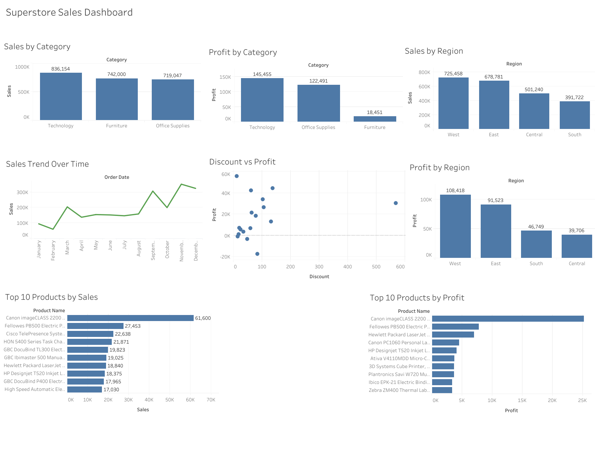

# Superstore Sales Analysis

## Project Overview

This project presents an end-to-end analysis of Superstore sales data using Python and Tableau.

The project starts with the original Superstore dataset, which was cleaned and preprocessed before performing the analysis. Exploratory data analysis was then carried out using Python and Jupyter Notebook to understand sales, profit, discounts, categories, regions, products, and sales trends.

The cleaned dataset was also used to create a Tableau dashboard that presents the analysis through interactive visualizations.

### The project contains:

- Data cleaning and preprocessing
- Exploratory Data Analysis (EDA)
- Sales and profit analysis
- Category-wise analysis
- Region-wise analysis
- Time-based sales analysis
- Discount vs Profit analysis
- Top 10 products by sales
- Top 10 products by profit
- Tableau dashboard for visual presentation
- Business findings and recommendations

## Tools & Technologies

- Python
- Pandas
- NumPy
- Matplotlib
- Jupyter Notebook
- Tableau Public

## Dataset

The project started with the original Superstore dataset.

The dataset was cleaned and preprocessed by the author before performing the analysis and creating the Tableau dashboard.

The cleaned dataset used in the project is included in this repository as:

`Superstore_Cleaned.csv`

## Data Cleaning & Preprocessing

The dataset was prepared for analysis using Python and Pandas.

The preprocessing stage included checking and preparing the data so that it could be used reliably for exploratory analysis and visualization.

The cleaned dataset was then used for the subsequent analysis and Tableau dashboard.

## Analysis Performed

The project analyzes the following areas:

- Sales analysis by category
- Profit analysis by category
- Sales analysis by region
- Profit analysis by region
- Sales trend over time
- Discount vs Profit analysis
- Top 10 products by sales
- Top 10 products by profit

## Tableau Dashboard

A Tableau dashboard was created using the cleaned dataset to provide a visual representation of the analysis.

### Dashboard Includes

- Sales by Category
- Profit by Category
- Sales by Region
- Profit by Region
- Sales Trend Over Time
- Discount vs Profit
- Top 10 Products by Sales
- Top 10 Products by Profit

### Dashboard Preview

## Key Findings

- Technology is one of the strongest-performing categories in terms of sales.
- Sales and profitability vary across different categories and regions.
- The West region shows strong overall sales and profit performance.
- Higher discounts can negatively affect profitability.
- Some products generate high sales but comparatively low or negative profit.
- The top products by sales are not necessarily the same as the top products by profit.
- Sales performance varies over time, with stronger and weaker periods visible in the sales trend.
- Product and customer-level analysis can help identify areas contributing to losses.

## Business Recommendations

- Monitor and control excessive discounting to protect profit margins.
- Focus on products that generate strong and consistent profits.
- Review products with high sales but low or negative profitability.
- Monitor regional performance and identify opportunities in weaker-performing areas.
- Evaluate sales and profit together rather than relying only on sales volume.
- Use product-level and customer-level analysis to identify areas requiring improvement.

## Conclusion

This project demonstrates that sales alone are not sufficient to evaluate overall business performance.

By analyzing sales, profit, discounts, categories, regions, products, and time-based trends together, the project provides a broader understanding of business performance.

The analysis highlights the importance of controlling excessive discounts, focusing on profitable products and customers, and monitoring category and regional performance.

The Tableau dashboard presents these findings visually, making the analysis easier to understand and supporting data-driven business decision-making.

## Files in this Repository

- `Superstore_Sales_Analysis.ipynb` – Jupyter Notebook containing the complete data analysis
- `Superstore_Cleaned.csv` – dataset cleaned and preprocessed by the author
- `dashboard.png` – Tableau dashboard exported as a PNG image

## Author

**Sameer Barwal**
Testing my first pull request
